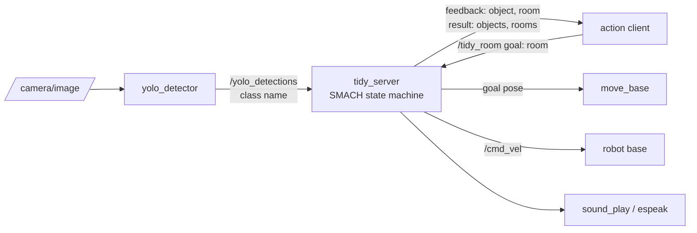
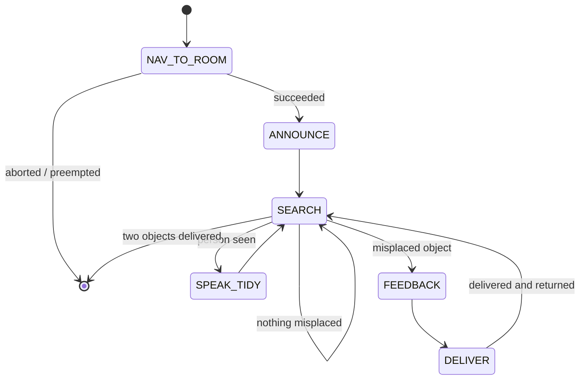

# Tidy-Up Robot

[](https://github.com/madmaxfv0/tidy-up-robot/actions/workflows/ci.yml)

A ROS package that makes a TurtleBot3 tidy a room. Given a room name, the robot drives there, looks around with a YOLOv4 object detector, and carries anything that does not belong to a room where it does, announcing what it is doing when it sees a person. The behaviour is a SMACH state machine running inside an actionlib server.

## Problem and purpose

A mobile robot that does a household task has to combine three things that are usually taught separately: navigation to a goal, perception from a camera, and a decision process that reacts to what it sees. This package wires those together in one behaviour: *find what is out of place here, work out where it belongs, take it there, come back, repeat*.

## Project status

**Academic coursework, complete.** Written individually for *Introduction to Robotics* (4CCSAITR) at King's College London, March 2026, and developed in the Stage 2D simulator inside the module's ROS container.

**It has not been re-run for this repository.** I do not have the ROS environment on this machine, so the package here is the submitted code plus one portability fix (see [docs/repository-cleanup.md](docs/repository-cleanup.md)). The decision logic is covered by tests that run without ROS.

There are no screenshots: the simulator and its test videos belong to the module and were not available when this repository was prepared.

## Main features

- **`/tidy_room` action server** taking a room name as the goal, publishing feedback for each misplaced object, and returning the objects moved and where they went — [`scripts/tidy_server.py`](scripts/tidy_server.py), [`action/TidyUp.action`](action/TidyUp.action).
- **SMACH state machine** with six states, passing the target room, the detected object and the running results through userdata — [`scripts/states.py`](scripts/states.py).
- **YOLOv4 detector node** that samples every tenth camera frame and publishes confident detections (above 0.5) as class names on `/yolo_detections` — [`scripts/yolo_detector.py`](scripts/yolo_detector.py).
- **Room knowledge as data**: a map position and a set of belonging objects for each of six rooms. A detection is "misplaced" if it is not in the current room's set and some other room lists it.
- **Speech**: announces arrival, and what it is doing when a person is detected, through `sound_play` with an `espeak` fallback.
- **Two smaller nodes** from the same coursework: a vacuum-cleaner state machine ([`scripts/vacuum_sm.py`](scripts/vacuum_sm.py)) and detection-driven navigation ([`scripts/yolo_nav.py`](scripts/yolo_nav.py)).

## Technology stack

| Technology | Role |
|---|---|
| ROS 1 (Noetic), Python 3 (`rospy`) | Nodes, topics, the action interface. |
| `actionlib` | The `/tidy_room` server, and the client side of `move_base`. |
| SMACH (`smach`, `smach_ros`) | The state machine, including `SimpleActionState` and `CBState`. |
| `move_base` | Path planning and driving to a map position. |
| YOLOv4 on Darknet (Python wrapper), OpenCV, `cv_bridge` | Object detection on camera frames. |
| `sound_play` / `espeak` | Text to speech. |
| Stage | 2D simulator used for development. |
| pytest, GitHub Actions | Decision-logic tests with ROS stubbed out. |

## Architecture



The state machine built for each goal:



Topics, the action definition, userdata keys and the room table are in [docs/interfaces.md](docs/interfaces.md).

## Quick start

### Without ROS (any machine)

```bash
python3 -m pip install pytest
```

```bash
python3 -m pytest -q
```

### With ROS

Requirements, none of which are in this repository:

- ROS Noetic with `move_base`, `smach_ros`, `sound_play`, `cv_bridge`, a TurtleBot3 Stage world and its map.
- Darknet with YOLOv4 at `/opt/darknet` (`cfg/yolov4.cfg`, `yolov4.weights`, `libdarknet.so`, `data/coco.names`) and the `yolov4` Python wrapper.
- A camera publishing `sensor_msgs/Image` on `/camera/image`.

The package name is `second_coursework`, so clone into a folder of that name:

```bash
cd ~/catkin_ws/src && git clone <this-repository-url> second_coursework
```

```bash
cd ~/catkin_ws && catkin_make && source devel/setup.bash
```

With a simulator, map, localisation and `move_base` already running:

```bash
roslaunch second_coursework student_nodes.launch
```

```bash
rostopic pub -1 /tidy_room/goal second_coursework/TidyUpActionGoal "{goal: {room: 'kitchen'}}"
```

`launch/second_coursework.launch` is the module's own top-level launch file. It also starts the module's simulator world, speech packages and a video-playback node (`itr_cw_AI_2526`) that stands in for the camera; those are course materials and are not included.

## Example workflow

1. A client sends the goal `room: "kitchen"`.
2. `NAV_TO_ROOM` drives to the kitchen through `move_base`; `ANNOUNCE` says "I have arrived at the kitchen".
3. `SEARCH` drives a short arc, stops, and reads the latest detection. A `bottle` belongs in the kitchen and is ignored.
4. A `laptop` is detected. It is not a kitchen object, and `bedroom-1` lists it, so `FEEDBACK` publishes `object: "laptop", room: "bedroom-1"`.
5. `DELIVER` drives to bedroom 1, records the delivery, and drives back to the kitchen.
6. After a second delivery, the server returns `objects: [...]`, `rooms: [...]` and succeeds.

## Engineering decisions

| Decision | Why | Trade-off |
|---|---|---|
| Detector as a separate node publishing plain class names | The state machine depends on a topic, not on Darknet; it can be driven by any publisher, including a test. | Bounding boxes and confidence are discarded. |
| Room knowledge in two dictionaries | Adding a room or object is a data change, and the logic is testable without a robot. | Coordinates are hand-calibrated room centres, not derived from the map. |
| `SimpleActionState` for the first navigation, a hand-written state for deliver-and-return | The first leg is a plain `move_base` call. The delivery leg has to go, check for a person, record the result and come back, which is one unit of work. | `DELIVER` does more than one thing and does not branch on navigation failure. |
| Move, stop, then read the detection | The detector gets a steady frame and the robot still covers floor area between looks. | Searching is slow and follows a fixed four-step motion pattern. |
| Deliberately compact code | Part of the mark was a code-conciseness score (Halstead volume). | Less defensive handling than a production node would have. |

## Testing and evaluation

```bash
python3 -m pytest -q
```

Fourteen tests in [`tests/test_room_logic.py`](tests/test_room_logic.py) import `scripts/states.py` with the ROS packages replaced by small stand-ins, and check: every room has a position and an object list; misplaced objects are routed to a room that lists them and never to the room being tidied; objects that belong, or belong nowhere, are ignored; a person is reported; and the search stops after two deliveries.

Not tested here: anything that needs ROS — navigation, the action interface end to end, YOLO inference, speech and timing. Those were exercised in the simulator during the module.

## Limitations and roadmap

**Current limitations**

- Requires the module's container layout (`/opt/darknet`, GPU id 0); paths to the model are not parameters.
- Room positions are approximate centres on one specific map.
- Only the most recent detection is kept, so two objects seen in the same pause yield one.
- An object that belongs to several rooms is sent to the first match.
- While delivering, a person is only checked for on arrival and on return, not along the way.
- A failed navigation during delivery is not detected.

**Possible next steps**

- Move model paths, the confidence threshold and room data to ROS parameters or a YAML file.
- Publish full detections (class, confidence, box) with a custom message.
- Rename the package and add a self-contained simulation launch so it runs outside the module's container.

## Authorship and acknowledgements

The nodes in `scripts/`, the action definition and `launch/student_nodes.launch` were written by **Fakhriyya Vazirova**.

`launch/second_coursework.launch`, the task specification and the simulator setup come from the module (4CCSAITR, King's College London). The YOLO node follows the detector interface taught in the module. `cfg/coco.data` is the standard Darknet COCO metadata file. YOLOv4 and Darknet are by Alexey Bochkovskiy and Joseph Redmon.

`package.xml` declares an MIT licence for the package, as created with the original submission. No separate licence file has been added.
